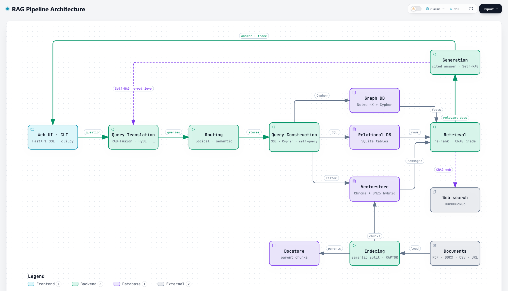

# RAG Pipeline

A modular Retrieval-Augmented Generation pipeline built stage by stage after the
classic *RAG from scratch* architecture: **Query Translation → Routing → Query
Construction → (Graph DB · Relational DB · Vectorstore) → Retrieval →
Generation**, fed by an **Indexing** stage. Swap your documents, get a chatbot.

---

## Architecture

<picture>
  <source media="(prefers-color-scheme: dark)" srcset="docs/architecture-dark.png">
  
</picture>

Interactive version (zoom, trace a route, click a box to jump to its source at
the pinned commit): download and open [`docs/architecture.html`](docs/architecture.html).
The diagram was generated with [Archify](https://github.com/tt-a1i/archify) from
the repository source; its candidate lives in `docs/architecture.json`.

| Stage | What this repo does | Code |
| --- | --- | --- |
| **Query Translation** | Multi-Query, RAG-Fusion, Decomposition, Step-Back, HyDE (pseudo-documents); follow-ups are rewritten into standalone questions first | `src/query_translation/` |
| **Routing** | *Logical*: the LLM picks the data store(s) for the question. *Semantic*: the question is embedded and the closest prompt (explain / compare / numbers / summarize / general) is chosen | `src/routing/` |
| **Query Construction** | *Text-to-SQL* for the relational DB, *Text-to-Cypher* for the graph DB, *self-query* metadata filters (file, passage type, page) for the vectorstore | `src/query_construction/` |
| **Data stores** | Chroma vectorstore (dense + BM25 hybrid search), SQLite relational DB of every extracted table and CSV, NetworkX knowledge graph queried with Cypher | `src/stores/` |
| **Indexing** | Semantic splitter (chunk optimization), parent-document / summary multi-representation indexing, configurable embedding models, RAPTOR summary tree | `src/indexing/` |
| **Retrieval** | *Ranking*: cross-encoder, Cohere, RankGPT or ColBERT-style re-ranking (plus RRF in RAG-Fusion). *Refinement*: CRAG relevance grading drops irrelevant documents. *Active retrieval*: CRAG rewrites the query and searches again, plus the web | `src/retrieval/` |
| **Generation** | Grounded, cited answers; *Self-RAG / RRR* checks every answer is grounded and on-topic, and regenerates or re-retrieves if not | `src/generation/` |

Every step streams to the web UI and the CLI as it happens, so you can watch a
question move through the diagram.

---

## Quick Start

### 1. Install dependencies

```bash
uv sync                          # or: pip install -r requirements.txt
```

### 2. Set API keys

Create a `.env` file in the project root (auto-loaded on startup):

```env
GOOGLE_API_KEY=your-gemini-key
GROQ_API_KEY=your-groq-key
```

### 3. Add your documents

Place documents in `sample_docs/` or list them in `config/config.yaml`:

```yaml
documents:
  sources:
    - "./sample_docs/"            # local directory
    - "./my_report.pdf"           # single file
    - "https://example.com/page"  # web URL
```

### 4. Index them

```bash
python ingest.py               # add/refresh configured sources (keeps UI uploads)
python ingest.py --rebuild     # wipe every store and rebuild from configured sources only
```

Indexing fills all three stores: chunks and RAPTOR summaries go to the
vectorstore, parent chunks to the docstore, tables and CSVs to the relational DB,
and LLM-extracted entities and relationships to the graph DB. Re-running replaces
a file's previous data instead of duplicating it.

### 5. Chat

**Web UI** (FastAPI + plain HTML/JS, no build step):

```bash
python app.py                  # then open http://localhost:7860
```

Add files from the sidebar or drop them anywhere on the page. A file is
searchable within seconds to a couple of minutes, while graph extraction and
RAPTOR summaries finish in the background with a progress bar. Under each
question a coloured bar shows the five stages (translate, route, construct,
retrieve, answer), each sized by the time it took; click it for the
step-by-step trace with the SQL, Cypher or filter that was built. Citations
like `[1]` jump to their source passage, Stop cancels an answer, and errors
such as used-up API quotas are explained in plain words instead of raw API
messages. Add `?q=your+question` to the URL to ask on load. If there is no
index yet, the app builds one from the configured sources on startup.

**Terminal:**

```bash
python cli.py
```

### 6. Run the tests

```bash
uv run pytest                  # offline: fake embeddings + scripted LLM, no API keys needed
```

---

## Project Layout

```
RAG/
├── config/config.yaml           # ← edit this file
├── src/
│   ├── config.py                # Pydantic config loader
│   ├── query_translation/       # multi-query, RAG-Fusion, decomposition, step-back, HyDE, follow-up rewrite
│   ├── routing/                 # logical (LLM picks the store) and semantic (embedding picks the prompt)
│   ├── query_construction/      # Text-to-SQL, Text-to-Cypher, self-query filters
│   ├── stores/                  # Chroma vectorstore, SQLite relational DB, knowledge graph
│   ├── indexing/                # loaders (tables, OCR), semantic splitter, embeddings,
│   │                            # parent-document/summary representations, RAPTOR
│   ├── retrieval/               # hybrid search, ranking, CRAG refinement and active retrieval
│   ├── generation/              # LLM factory (+ fallback), grounded prompt, Self-RAG checks
│   ├── pipeline/                # orchestrator: ingestion and the event-streaming query run
│   └── chat/                    # conversation memory
├── web/                         # UI: index.html, app.js, style.css
├── tests/                       # offline tests
├── app.py                       # FastAPI server (SSE chat stream, uploads)
├── cli.py                       # terminal chatbot
└── ingest.py                    # document ingestion
```

---

## Configuration

Everything lives in **`config/config.yaml`**. Each stage can be switched off on
its own.

### Query translation

```yaml
retrieval:
  strategy: "rag_fusion"   # simple | multi_query | rag_fusion | hyde | step_back | decomposition
  top_k: 5
  planner: true            # one LLM call plans translation + routing + self-query filter
  hybrid:
    enabled: true          # dense + BM25 keyword search
```

### Routing and query construction

```yaml
routing:
  logical: true            # LLM picks vectorstore / relational_db / graph_db
  semantic: true           # embedding picks the prompt; edit routing.prompts to add your own

query_construction:
  text_to_sql: true
  text_to_cypher: true
  self_query: true
```

With `retrieval.planner: true` (the default) query translation, logical
routing and the self-query filter come from **one** LLM call; they still
appear as separate steps in the trace. No call is made at all when there is
nothing to decide (simple strategy, one store, nothing to filter). Set
`planner: false` to give each stage its own call.

### Data stores

```yaml
relational_db:
  enabled: true
  path: "./data/relational.sqlite"

graph_db:
  enabled: true                 # extracted in the background after a file is searchable
  path: "./data/graph.json"
  extraction_batch_chars: 12000 # text per extraction call
```

### Indexing

```yaml
chunking:
  chunk_size: 400               # tokens; keep under the embedding model's input limit
  chunk_overlap: 60
  method: "semantic"            # semantic | recursive
  semantic_boundaries: "lexical" # lexical (TF-IDF, near instant) | embedding (sharper, slow on CPU)

indexing:
  multi_representation: "parent_document"   # none | parent_document | summary
  parent_chunk_size: 1000
  llm_concurrency: 4            # LLM calls at once during background enrichment
  raptor:
    enabled: true               # per file, in the background; one LLM call per cluster
    cluster_size: 10
    max_levels: 3

embedding:
  provider: "huggingface"       # huggingface | google | openai
  model: "BAAI/bge-small-en-v1.5"
  query_instruction: "Represent this sentence for searching relevant passages: "
```

### Retrieval

```yaml
reranking:
  enabled: true
  provider: "cross_encoder"     # cross_encoder | cohere | rankgpt | colbert
  model: "cross-encoder/ms-marco-MiniLM-L-6-v2"
  candidates: 20
  top_k: 5

retrieval:
  crag:
    enabled: true               # grade documents, drop irrelevant ones
    grader: "reranker"          # reranker (cross-encoder score, no LLM call) | llm
    min_score: -6.0             # cross-encoder score that counts as relevant
    min_relevant: 1             # fewer relevant than this → rewrite + search again
    web_search: true            # DuckDuckGo, no API key
```

For `colbert`, point `reranking.model` at a ColBERT or other BERT checkpoint;
documents are scored by MaxSim over token embeddings.

### Generation

```yaml
generation:
  self_rag:
    enabled: true               # grounded? answers the question? retry if not
    max_retries: 1

llm:
  provider: "google"            # google | groq | openai | ollama
  model: "gemini-3.6-flash"
  max_retries: 3
  failover_cooldown_seconds: 60 # minimum pause for a rate-limited model
  fallback:                     # used the moment the primary errors
    provider: "groq"
    model: "openai/gpt-oss-120b"
```

With a fallback configured, a rate-limited or failing primary hands the call to
the fallback immediately (no retry wait) and is skipped until the provider's
own retry time has passed, which for a used-up daily quota can be hours. The
sidebar shows which model is paused and why.

### Latency and the LLM call budget

A question costs **2 to 4 LLM calls**: the planner (translation, routing and
the filter in one call), Text-to-SQL / Text-to-Cypher only when the router picks
those stores (run in parallel with the vector search), the answer, and the
Self-RAG check after the answer has already streamed. CRAG grades relevance
with the cross-encoder scores re-ranking already produced, so it costs no
call unless it has to search again. Follow-ups add one call to rewrite the
question. The coloured bar under each answer shows how long each stage took.

Free-tier quotas are tight (Gemini's free tier allows 20 requests a day per
model, Groq limits tokens per minute), so keep the fallback configured. For
the lightest setup use `strategy: "simple"` and turn off `self_rag`.

### Indexing speed

Uploading makes a file searchable as soon as it is loaded, chunked and
embedded; graph extraction and RAPTOR summaries then run in the background
with progress in the sidebar, and you can ask questions meanwhile. On a
346-page PDF on a laptop CPU the searchable phase went from about 4 minutes
plus roughly 50 minutes of blocking LLM calls to under 2 minutes, and the
background enrichment makes about a tenth as many LLM calls as before.
Embedding is the remaining floor on CPU; a GPU, or `embedding.provider:
"google"`, makes it much faster.

---

## Supported Document Types

| Type       | Extension       | Loader                                          | Also goes to |
| ---------- | --------------- | ----------------------------------------------- | ------------ |
| PDF        | `.pdf`          | PyPDFLoader + pdfplumber tables + Tesseract OCR | tables → relational DB |
| Plain Text | `.txt`          | TextLoader                                      | |
| Markdown   | `.md`           | TextLoader                                      | |
| Word       | `.docx`         | Docx2txtLoader + python-docx tables             | tables → relational DB |
| CSV        | `.csv`          | CSVLoader                                       | whole file → relational DB |
| HTML       | `.html`, `.htm` | BSHTMLLoader                                    | |
| Web URL    | `http://...`    | WebBaseLoader                                   | |

OCR needs the [Tesseract](https://github.com/tesseract-ocr/tesseract) binary on
your `PATH`. Without it, OCR is skipped with a warning.

---

## Advanced Usage

### Using Groq

```yaml
llm:
  provider: "groq"
  model: "openai/gpt-oss-120b"
```

Groq provides LLMs only, so pair it with `huggingface` or `google` embeddings.

### Using Ollama (local LLMs)

```yaml
llm:
  provider: "ollama"
  model: "llama3"
  base_url: "http://localhost:11434"
```

### Changing the embedding model

After changing `embedding.model`, run `python ingest.py` or start the app. The
old index is backed up to `vectorstore_db.backup-<timestamp>/` and its stored
chunks are re-embedded with the new model, so files that were only ever uploaded
through the UI are kept.
