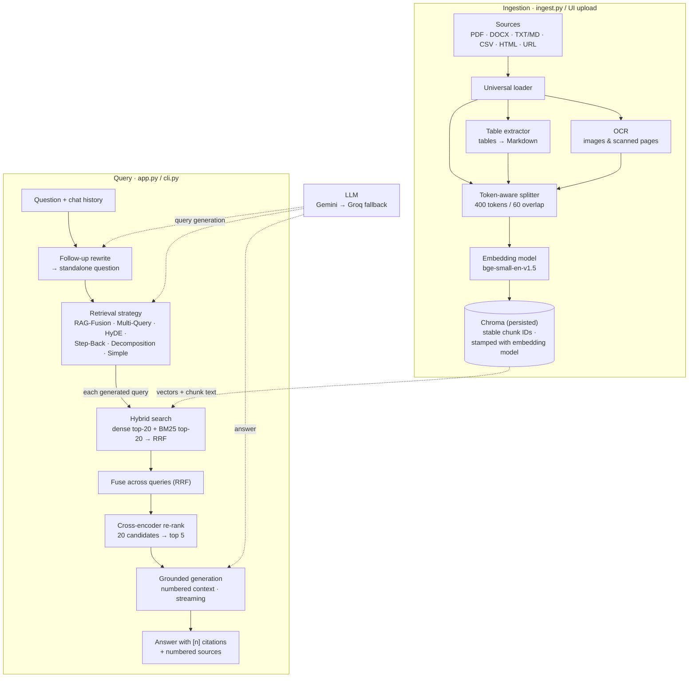

# RAG Pipeline

A modular Retrieval-Augmented Generation pipeline. **Swap your document, get a chatbot instantly.**

---

## Features

| Feature                    | Description                                                                                            |
| -------------------------- | ------------------------------------------------------------------------------------------------------ |
| **Hybrid Search**          | Dense vectors + BM25 keywords, fused with Reciprocal Rank Fusion, so exact names and IDs are found too |
| **RAG-Fusion + RRF**       | Generates query variants and fuses their rankings                                                      |
| **Multi-Query Retrieval**  | Query variants for broader recall                                                                      |
| **HyDE**                   | Searches with a hypothetical answer as well as the question                                            |
| **Step-Back Prompting**    | Adds a broader "step-back" question for background context                                             |
| **Question Decomposition** | Splits complex questions into sub-questions and fuses their results                                    |
| **Re-ranking**             | Cross-encoder (default) or Cohere scores a candidate pool and keeps the best                           |
| **Conversation Memory**    | Follow-ups are rewritten into standalone questions before searching                                    |
| **Citations**              | Answers cite numbered passages`[1]`; the source list matches the numbers                               |
| **LLM Fallback**           | A second model takes over when the primary errors (rate limits, outages)                               |
| **Universal Loader**       | PDF, TXT, MD, DOCX, CSV, HTML, URLs, plus tables → Markdown and image OCR                              |
| **Web UI + CLI**           | Streaming Gradio chatbot with document upload, and a terminal chatbot                                  |
| **Single Config**          | One YAML file controls everything                                                                      |

---

## Quick Start

### 1. Install Dependencies

```bash
uv sync                          # or: pip install -r requirements.txt
```

### 2. Set API Keys

Create a `.env` file in the project root (auto-loaded on startup):

```env
GOOGLE_API_KEY=your-gemini-key
GROQ_API_KEY=your-groq-key
```

### 3. Add Your Documents

Place your documents in `sample_docs/` or edit `config/config.yaml`:

```yaml
documents:
  sources:
    - "./sample_docs/" # Local directory
    - "./my_report.pdf" # Single file
    - "https://example.com/page" # Web URL
```

### 4. Ingest Documents

```bash
python ingest.py               # add/refresh configured sources (keeps UI uploads)
python ingest.py --rebuild     # wipe the index and rebuild from configured sources only
```

Re-running ingestion replaces chunks from the same files instead of duplicating them.

### 5. Start Chatting

**Web UI (Gradio):**

```bash
python app.py
```

If there is no index yet, the app builds one from the configured sources on startup. You can also upload files from the UI.

**Terminal CLI:**

```bash
python cli.py
```

### 6. Run the Tests

```bash
uv run pytest                  # offline: fake embeddings + scripted LLM, no API keys needed
```

## Architecture



If the embedding model in the config changes, the stored index no longer matches. The pipeline backs up the old index and re-embeds its stored chunks with the new model, so files that were only ever uploaded through the UI are kept.

### Project Layout

```
RAG/
├── config/config.yaml          # ← Edit this file
├── src/
│   ├── config.py               # Pydantic config loader
│   ├── document_loaders/       # Universal loader, table extraction, OCR
│   ├── chunking/               # Token-aware text splitting
│   ├── embeddings/             # Embedding model factory
│   ├── vectorstore/            # Chroma persistence, chunk IDs, model guard
│   ├── retrieval/
│   │   ├── hybrid.py           # Dense + BM25 hybrid search
│   │   ├── utils.py            # RRF and query-list parsing
│   │   ├── multi_query.py      # Multi-query retrieval
│   │   ├── rag_fusion.py       # RAG-Fusion + RRF
│   │   ├── hyde.py             # HyDE
│   │   └── reranker.py         # Re-ranking layer
│   ├── query_transform/
│   │   ├── condense.py         # Follow-up → standalone question
│   │   ├── decomposition.py    # Question decomposition strategy
│   │   └── step_back.py        # Step-back strategy
│   ├── generation/             # LLM factory (+ fallback), grounded prompt, citations
│   ├── pipeline/               # Main orchestrator
│   └── chat/                   # Conversation memory
├── tests/                      # Offline end-to-end tests
├── app.py                      # Gradio web UI
├── cli.py                      # Terminal chatbot
└── ingest.py                   # Document ingestion
```

## Configuration

All settings are in **`config/config.yaml`**. Key options:

### Retrieval Strategy

```yaml
retrieval:
  strategy: "rag_fusion" # simple | multi_query | rag_fusion | hyde | step_back | decomposition
  top_k: 5
  hybrid:
    enabled: true # dense + BM25 keyword search
```

### LLM Provider

```yaml
llm:
  provider: "google" # google | groq | openai | ollama
  model: "gemini-3.6-flash"
  temperature: 0.1
  max_retries: 3
  fallback: # optional; used when the primary model errors
    provider: "groq"
    model: "openai/gpt-oss-120b"
```

> Free-tier quotas are tight (Gemini Flash allows ~5 requests/minute), and one
> question can take up to 3 LLM calls: follow-up rewrite, query generation and the answer.
> Keep the fallback configured, or use `strategy: "simple"` to cut usage.

### Re-ranking

```yaml
reranking:
  enabled: true
  provider: "cross_encoder"
  model: "cross-encoder/ms-marco-MiniLM-L-6-v2"
  candidates: 20 # retrieved chunks the re-ranker scores
  top_k: 5 # chunks passed to the LLM
```

### Chunking and Embeddings

```yaml
chunking:
  chunk_size: 400 # tokens; keep under the embedding model's input limit
  chunk_overlap: 60

embedding:
  provider: "huggingface"
  model: "BAAI/bge-small-en-v1.5"
  query_instruction: "Represent this sentence for searching relevant passages: "
```

---

## Supported Document Types

| Type       | Extension       | Loader                                          |
| ---------- | --------------- | ----------------------------------------------- |
| PDF        | `.pdf`          | PyPDFLoader + pdfplumber tables + Tesseract OCR |
| Plain Text | `.txt`          | TextLoader                                      |
| Markdown   | `.md`           | TextLoader                                      |
| Word       | `.docx`         | Docx2txtLoader + python-docx tables             |
| CSV        | `.csv`          | CSVLoader                                       |
| HTML       | `.html`, `.htm` | BSHTMLLoader                                    |
| Web URL    | `http://...`    | WebBaseLoader                                   |

OCR needs the [Tesseract](https://github.com/tesseract-ocr/tesseract) binary on your `PATH`. Without it, OCR is skipped with a warning.

---

## Advanced Usage

### Using Groq (Fast, Free Tier)

```yaml
llm:
  provider: "groq"
  model: "openai/gpt-oss-120b"
```

> Note: Groq provides LLMs only — pair it with `huggingface` or `google` embeddings.

### Using Google Gemini

```yaml
llm:
  provider: "google"
  model: "gemini-3.6-flash"

embedding:
  provider: "google"
  model: "models/gemini-embedding-001"
```

### Using Ollama (Local LLMs)

```yaml
llm:
  provider: "ollama"
  model: "llama3"
  base_url: "http://localhost:11434"
```

### Changing the Embedding Model

After changing `embedding.model`, run `python ingest.py` or start the app. The old index is backed up to `vectorstore_db.backup-<timestamp>/` and its chunks are re-embedded.
